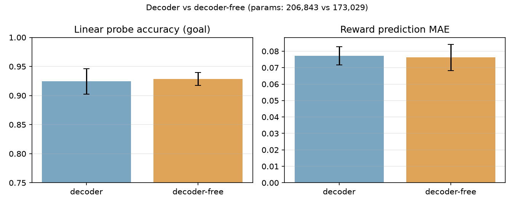
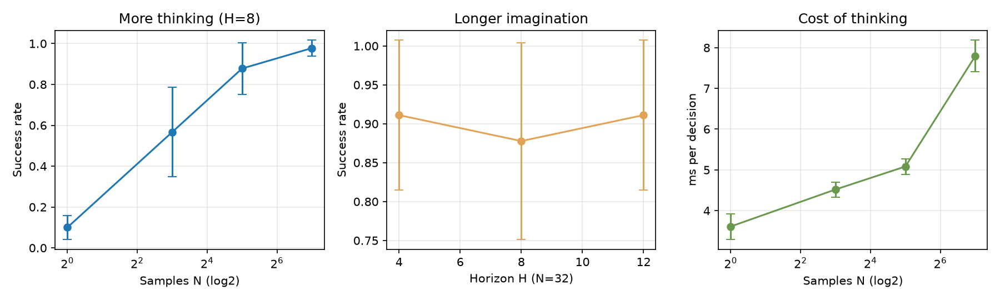
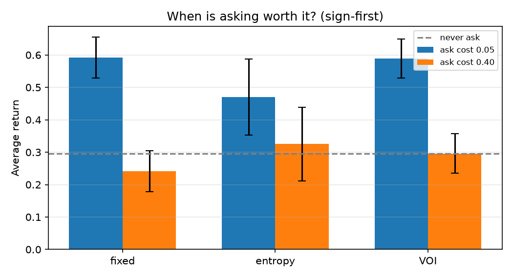

# AskDreamer 实验报告

**项目**：一个 CPU 可训练的“潜状态—思考—主动询问”小架构  
**日期**：2026-10-18  
**定位**：研究原型，不是大语言模型，也不是 DreamerV3 的复现  
**代码**：`D:\hide`  
**数据**：`experiments/logs/`（每个配置一个 JSON），表格由 `experiments/summarize.py` 从 JSON 自动生成

---

## 摘要

我在一个 7×7 的部分可观测网格世界里，搭了一个约 17–21 万参数的世界模型：它不重建观测，只用 RSSM 维护潜状态，用 JEPA 式目标预测下一时刻的嵌入；然后用随机 shooting 在潜空间里“思考”；最后用一个独立的询问控制器决定是否花代价执行 `ASK`。我用 3 个 seed 做了三组对照实验：

- **H1（无解码器 vs 有解码器）**：无解码器版本小 16%，任务指标有竞争力，但在 Brier、JEPA 相似度和有效秩上略差。**部分成立**。
- **H2（思考预算）**：采样数 N 从 1 增到 128，成功率从 10.0% 升到 97.8%；但规划视野 H 不是越大越好，H=4 的回报和延迟都优于 H=8/12。**成立，但有过拟合/漂移的边界**。
- **H3（询问策略）**：低询问成本下固定问和 VOI 门控都接近最好；高询问成本下固定问最差，VOI 自动退化为“不问”。熵门控对成本不敏感，在两个成本下都问 41.3%。**部分成立：VOI 的价值是跨成本自适应，而不是每个 regime 都最高**。

最重要的负结果：**“无解码器”没有全面胜出；“熵越小越该问”不是充分策略；“先读免费告示牌”会显著改变 VOI 的决策**。

---

## 1. 研究问题

现有大模型主要靠“大量算力 + 下一个 token 预测”。我想验证一个不同的小方向：

1. **不关注每个像素，只维护潜状态**：世界模型不重建观测，而是预测下一时刻的潜嵌入；
2. **自己思考**：不在像素/文字上搜索，而是在潜空间里 rollout 多条未来，选一条执行；
3. **主动询问**：不确定时，花一步和一点奖励向 oracle 提问，而不是盲目试错。

这三个想法分别对应 H1、H2、H3。需要强调：RSSM、JEPA、随机 shooting、VOI 都是已有思想；**我的贡献是提出并验证一个统一的 `ACT / THINK / ASK` 回路，以及“把 oracle 答案放在独立消息通道”的实验设计**，不是发明新的基础算法。

### 1.1 可检验假设

| 编号 | 假设 | 对照 | 主要指标 |
|---|---|---|---|
| H1 | 不重建观测、只预测潜状态，足够支撑任务 | 加解码器重建 150 维观测 | 奖励 MAE、信念准确率/Brier、线性探针、有效秩、参数量、训练时间 |
| H2 | 在潜空间里多采样几条未来，比反应式动作更好 | N=1/8/32/128；H=4/8/12 | 成功率、平均回报、平均步数、单步规划耗时 |
| H3 | 用信息价值/不确定性决定“何时问”，比从不问/固定问更好 | never / fixed / entropy / VOI；低/高询问成本 | 净回报、询问率、平均询问次数、成功率 |

---

## 2. 环境：HiddenGoalGrid

### 2.1 规则

- 7×7 网格，最外圈是墙；智能体从 `(1,1)` 出发。
- 三扇门固定在右侧：`(1,6), (3,6), (5,6)`；每局随机一扇是正确门 `goal ∈ {0,1,2}`。
- **`goal` 绝不进入观测**。它只出现在 `info["goal"]` 里，训练时作为信念头的特权标签。
- 观测是以智能体为中心的 **5×5 局部视野**，6 个通道：墙、门 0、门 1、门 2、告示牌、自己；展平为 **150 维**。
- 另有一条独立的 **6 维消息通道**：前 3 维表示告示牌排除了哪扇门，后 3 维表示 oracle 的回答。
- 动作 5 个：上/下/左/右/`ASK`。
- 奖励：正确门 `+1` 并结束；错误门 `−0.3`，该门变成墙；每步 `−0.01`；`ASK` 额外 `−0.05`；40 步超时再 `−0.1`。
- 告示牌：走上去会排除一扇错误门，不直接给奖励。它让“问不问”不总是显然的。

### 2.2 为什么把 oracle 答案放在独立消息通道

如果答案直接拼进 150 维观测，信念头可以从观测里“抄答案”，H3 就失去意义。现在：

- 观测里没有 `goal`；
- oracle 答案只能通过 `ASK` 写入消息通道；
- 智能体必须自己决定要不要买这个信息。

这相当于一个最小的 POMDP：隐藏状态是 `goal`，动作 `ASK` 是一个有代价的观测动作。

### 2.3 随机策略基线

200 局随机策略：成功率 **7.5%**，平均回报 **−0.842**，平均步数 **39.0**，询问率 **0.200**。随机策略偶尔能撞对门，但不会利用告示牌或 oracle。

---

## 3. 模型与算法

### 3.1 世界模型

```
观测 o_t (150) ──► Encoder ──► e_t (64)
                                  │
消息 m_t (6) ─────────────┐       │
动作 a_{t-1} (5) ─────────┼──► GRU ──► h_t (96)
潜变量 z_{t-1} (16) ──────┘             │
                                        ├── prior   p(z_t | h_t)
                                        ├── posterior q(z_t | h_t, e_t)   （训练时）
                                        │
                                        ├── 奖励头 R(h,z,a) → r_t
                                        ├── 信念头 B(h,z) → 3 类 q(goal)
                                        ├── 价值头 V(h,z) → 折扣回报
                                        └── JEPA 头 → 预测下一时刻 e_{t+1}
```

- **RSSM-lite**：`h_t` 是 96 维确定性状态，`z_t` 是 16 维对角高斯潜变量。训练用 posterior，想象/规划用 prior。
- **无解码器主模型**：不重建 150 维观测；JEPA 头用 `(h_t,z_t,a_t)` 预测 `sg(e_{t+1})`，目标编码器做 EMA（decay 0.99），stop-gradient。
- **防坍塌**：VICReg 式方差项（`relu(1 - std).mean()`），并监控有效秩、posterior/prior 标准差、线性探针。
- **KL**：`0.8 * KL(sg(q)||p) + 0.2 * KL(q||sg(p))`，每维 free bits 0.5 nat；同时记录未裁剪的 `kl_raw` 和活跃维数。
- **可选解码器**：只作为 H1 的对照（默认开启；`--no-decoder` 关闭），主目标是潜状态预测。

### 3.2 思考：随机 shooting 规划

从当前 `(h_t,z_t)` 出发：

1. 采样 N 条长度 H 的**移动动作**序列（0..3，不含 `ASK`）；
2. 用 prior 在潜空间里 rollout，累加预测奖励；
3. 加上 `γ^H · V(h_H,z_H)`，用价值头给远期一个 bootstrap；
4. 选总分最高的序列，执行第一个动作。

N 就是“思考预算”。价值头是 H2 能跑通的关键：没有它，稀疏的 `+1` 奖励几乎搜不到通往门的动作序列。

### 3.3 询问：规则版控制器

`ASK` 不放进规划器的动作空间，而由单独控制器决定：

| 控制器 | 规则 |
|---|---|
| `never` | 从不问 |
| `fixed` | 第一次有机会就问 |
| `entropy` | 信念熵 > τ 才问，每局最多一次 |
| `voi` | 估计“不问的期望试错成本” > “询问成本”才问 |
| `sign_first` | 先走到告示牌；读完后才把决策交给上面的策略 |

VOI 的粗略计算：

```
p_max = max(q(goal))
expected_wrong_tries = (1 - p_max) / p_max
expected_try_cost = expected_wrong_tries * (|wrong_penalty| + |step_penalty|)
ask if expected_try_cost > |ask_cost| + margin
```

---

## 4. 实验设置

### 4.1 数据

- 400 局 `mixed` 策略数据（70% 脚本策略 + 30% 随机策略）；
- 每局补齐到 40 步，用 `valid` 标记真实步数；
- 90% 训练 / 10% 验证（按 episode 划分，避免同一局泄漏）；
- 序列长度 16，batch 32。

### 4.2 训练

| 项目 | 值 |
|---|---|
| 优化器 | AdamW，lr 3e-4，weight decay 1e-5 |
| 训练步数 | 2000 |
| 梯度裁剪 | 1.0 |
| EMA decay | 0.99 |
| 线程 | `torch.set_num_threads(3)`（4 核 CPU 留一核给系统） |
| 参数量 | 173,029（无解码器）/ 206,843（有解码器） |
| 训练时间 | 约 93–97 秒 / seed |

### 4.3 评估

- **世界模型**：在 10% 验证集上算 reward MAE、value MAE、belief accuracy、Brier、JEPA cosine、线性探针准确率、多数类基线、有效秩。
- **规划**：3 seeds × 30 局（H2），3 seeds × 50 局（H3），报告均值 ± 样本标准差。
- **询问**：成功率、平均回报、询问率（至少问一次的比例）、平均询问次数、平均步数。

### 4.4 可复现性

- `seed_everything(seed)`：Python `random`、numpy、torch；
- `torch.use_deterministic_algorithms(True, warn_only=True)`；
- 所有指标写入 JSON，表格和图由 `experiments/summarize.py` 生成，不手工改数；
- 3 个 seed：0/1/2。

---

## 5. H1：无解码器 vs 有解码器

### 5.1 结果

| 版本 | 参数量 | 训练秒 | reward MAE | value MAE | belief acc | Brier | JEPA cos | probe acc | 多数类 | 有效秩 |
|---|---:|---:|---:|---:|---:|---:|---:|---:|---:|---:|
| 有解码器 | 206,843 | 97.1 ± 2.0 | 0.077 ± 0.006 | 0.225 ± 0.036 | 0.934 ± 0.004 | 0.077 ± 0.003 | 0.882 ± 0.018 | 0.924 ± 0.022 | 0.432 ± 0.017 | 8.50 ± 0.25 |
| 无解码器 | 173,029 | 92.7 ± 2.1 | 0.076 ± 0.008 | 0.226 ± 0.035 | 0.932 ± 0.003 | 0.080 ± 0.007 | 0.878 ± 0.020 | 0.928 ± 0.011 | 0.432 ± 0.017 | 8.34 ± 0.28 |



### 5.2 怎么读

- **参数量**：无解码器少 33,814 个参数（约 **16.3%**）；训练时间少约 4.5%。
- **奖励预测**：0.076 vs 0.077，无解码器略好，但差异远小于标准差。
- **信念**：0.932 vs 0.934，基本持平；Brier 0.080 vs 0.077，有解码器略好。
- **潜变量质量**：线性探针 0.928 vs 0.924，无解码器略好；JEPA cosine 0.878 vs 0.882、有效秩 8.34 vs 8.50，有解码器略好。
- **探针 vs 多数类**：0.928 vs 0.432。说明 `z_t` 确实编码了隐藏门信息，而不是只会猜多数类。

### 5.3 结论

**H1 部分成立**：无解码器版本在参数量、训练时间、reward MAE 和线性探针上有优势，在 Brier、JEPA、有效秩上略差；所有差异都不大。更准确的说法是：

> “不重建观测也能学到足够好的潜状态”成立；  
> “不重建观测全面优于重建”不成立。

这也符合预期：解码器提供了一个额外的监督信号，可能让嵌入更平滑、校准更好；但它不是任务成功的必要条件。

### 5.4 下游规划（初步）

用 seed 0 的 checkpoint 做规划评估：

- 无解码器：30 局，H=8，N=32，固定询问，成功率 **93.3%**，平均回报 **0.504**；
- 有解码器：50 局，H=8，N=32，固定询问，成功率 **90.0%**，平均回报 **0.540**。

两者局数不同，只能作为初步参考，不能当作严格的 H1 下游结论。正式的下游对比需要 3 个 seed、相同局数。

---

## 6. H2：思考预算

### 6.1 结果

3 seeds × 30 局/seed，固定询问，N/H 变化：

| 配置 | 成功率 | 平均回报 | 平均步数 | 单步规划 ms |
|---|---:|---:|---:|---:|
| N=1, H=8 | 0.100 ± 0.058 | −0.496 ± 0.070 | 38.6 ± 1.4 | 3.61 ± 0.31 |
| N=8, H=8 | 0.567 ± 0.219 | 0.106 ± 0.270 | 30.4 ± 3.8 | 4.52 ± 0.18 |
| N=32, H=8 | 0.878 ± 0.126 | 0.491 ± 0.143 | 22.2 ± 2.4 | 5.08 ± 0.19 |
| N=128, H=8 | 0.978 ± 0.038 | 0.674 ± 0.038 | 15.8 ± 1.3 | 7.79 ± 0.39 |
| N=32, H=4 | 0.911 ± 0.096 | 0.626 ± 0.138 | 18.6 ± 4.0 | 2.62 ± 0.25 |
| N=32, H=12 | 0.911 ± 0.096 | 0.444 ± 0.121 | 24.5 ± 1.0 | 7.80 ± 0.57 |



### 6.2 怎么读

**N 越大越好。** N=1 基本是“随便挑一个动作”，成功率只有 10.0%；N=8 已经到 56.7%；N=32 到 87.8%；N=128 到 97.8%。单步耗时从 3.61 ms 增到 7.79 ms，仍然很便宜。这说明“多想几条”确实有用，而且是这个架构里最稳定的收益来源。

**H 不是越大越好。** 在 N=32 时：

- H=4：成功率 0.911，回报 0.626，单步 2.62 ms；
- H=8：成功率 0.878，回报 0.491，单步 5.08 ms；
- H=12：成功率 0.911，回报 0.444，单步 7.80 ms。

H=4 的回报最高、延迟最低；H=12 的成功率和 H=4 一样（在 seed 波动内），但回报更低、延迟约为 3 倍。原因是 **prior 长 rollout 会漂移**：世界模型在训练时只见过 16 步的序列，且没有用真实观测校正；推得越远，预测奖励越不可信，价值头的 bootstrap 也补不回来。

### 6.3 结论

**H2 成立**：在潜空间里多采样，显著优于反应式/单样本动作。  
**但有一个重要边界**：思考的“宽度”（N）比“深度”（H）更可靠；在当前世界模型精度下，H=4 左右是性价比最高的。

---

## 7. H3：什么时候问

### 7.1 结果

3 seeds × 50 局/seed。`sign_first` 表示先走到告示牌，再决定是否询问；“先读牌 + 从不问”作为不询问的基线。

| 策略 | 询问成本 | 成功率 | 平均回报 | 询问率 | 平均询问次数 | 平均步数 |
|---|---:|---:|---:|---:|---:|---:|
| 先读牌 + 从不问 | 0.00 | 0.807 ± 0.064 | 0.296 ± 0.061 | 0.000 ± 0.000 | 0.00 ± 0.00 | 24.5 ± 0.4 |
| 先读牌 + 固定问 | −0.05 | 0.953 ± 0.042 | 0.592 ± 0.063 | 1.000 ± 0.000 | 1.00 ± 0.00 | 18.7 ± 1.7 |
| 先读牌 + 固定问 | −0.40 | 0.953 ± 0.042 | 0.242 ± 0.063 | 1.000 ± 0.000 | 1.00 ± 0.00 | 18.7 ± 1.7 |
| 先读牌 + 熵门控 τ=0.8 | −0.05 | 0.873 ± 0.064 | 0.470 ± 0.118 | 0.413 ± 0.110 | 0.41 ± 0.11 | 19.8 ± 2.2 |
| 先读牌 + 熵门控 τ=0.8 | −0.40 | 0.873 ± 0.064 | 0.325 ± 0.114 | 0.413 ± 0.110 | 0.41 ± 0.11 | 19.8 ± 2.2 |
| 先读牌 + VOI 门控 | −0.05 | 0.953 ± 0.042 | 0.590 ± 0.060 | 0.967 ± 0.042 | 0.97 ± 0.04 | 18.7 ± 1.6 |
| 先读牌 + VOI 门控 | −0.40 | 0.807 ± 0.064 | 0.296 ± 0.061 | 0.000 ± 0.000 | 0.00 ± 0.00 | 24.5 ± 0.4 |
| 不先读牌 + 固定问 | −0.05 | 0.867 ± 0.129 | 0.499 ± 0.150 | 1.000 ± 0.000 | 1.00 ± 0.00 | 21.6 ± 2.8 |
| 不先读牌 + VOI 门控 | −0.40 | 0.827 ± 0.092 | 0.121 ± 0.128 | 0.913 ± 0.150 | 0.91 ± 0.15 | 22.5 ± 2.1 |



### 7.2 怎么读

**低询问成本（0.05）**：

- 固定问：回报 0.592；
- VOI：回报 0.590，询问率 96.7%；
- 熵门控：回报 0.470，询问率 41.3%；
- 从不问：回报 0.296。

在信息很便宜时，**几乎每次都问**是最优的；VOI 和固定问都接近这个上界。熵门控因为只问 41.3%，反而少拿了信息。

**高询问成本（0.40）**：

- 固定问：回报 0.242；
- 熵门控：回报 0.325；
- VOI：回报 0.296；
- 从不问：回报 0.296。

固定问的成功率仍是 0.953，但它每局都付 0.40，回报被拉低 0.35，反而**低于从不问**。熵门控在两个成本下的询问率都是 41.3%，因为它的决策只看信念熵，**完全不知道询问变贵了**；它的回报下降约 0.145，正好接近 `0.413 × 0.35`，说明它只是被动地付了更贵的账。VOI 则从“问 96.7%”自动切换到“问 0%”，回报回到“从不问”的水平。

**免费告示牌的作用**：

- 先读牌 + 固定问（低）：0.592；不先读牌 + 固定问（低）：0.499；
- 先读牌 + VOI（高）：0.296；不先读牌 + VOI（高）：0.121。

先读牌能排除一扇门，让信念更尖锐，也让 VOI 更准确地判断“值不值得问”。不先读牌时，初始信念接近均匀，VOI 在高成本下仍然问 91.3%，结果回报只有 0.121——它**高估了试错的成本**，或者说**低估了免费线索的价值**。这说明：**“何时问”不只取决于询问价格，也取决于你已经免费知道了多少。**

### 7.3 结论

**H3 部分成立**：

- “用信息价值决定何时问”在**跨成本**的意义上成立：VOI 在低成本和固定问打平，在高成本自动退化为不问，避免了固定问的损失；
- “熵门控比固定问更好”只在某些成本下成立；熵门控对成本不敏感，不能单独作为“何时问”的完整策略；
- “先读免费告示牌”是一个强先验，会显著改变最优询问率；没有它，VOI 在高成本下会过度询问。

更准确的总结是：

> **询问的价值 = 信息能避免的期望试错成本 − 询问价格。**  
> 只看不确定性（熵）不够，还要看“不问会错几次、每次多贵”，以及“有没有免费信息可以先拿”。

---

## 8. 负结果与需要谨慎的地方

这一节和正结果同样重要。

### 8.1 负结果

1. **无解码器没有全面胜出**：Brier、JEPA cosine、有效秩都是有解码器略好；差异在噪声内，但不能说“去掉解码器更好”。
2. **H=12 没有更好**：成功率与 H=4 持平，回报更低、延迟更高；长 rollout 的 prior 漂移是实际瓶颈。
3. **熵门控在高成本下只比“从不问”高 0.029**：0.325 vs 0.296，且标准差约 0.11，差异在噪声内。它不是一个可靠的“成本感知”策略。
4. **不先读牌的 VOI 在高成本下表现很差**：0.121，远低于“从不问”的 0.296；说明 VOI 的估计依赖信念质量，信念接近均匀时会过度询问。
5. **下游 H1 对比不严格**：无解码器 30 局、有解码器 50 局，不能直接比较；需要补 3 seeds × 相同局数。

### 8.2 Caveat

1. **世界模型在 `ask_cost=-0.05` 的数据上训练**。H3 高成本（−0.40）评估时，奖励头/价值头看到的询问代价与评估环境不一致；规划器只选移动动作，动作排序对常数偏移不敏感，但回报的绝对值要谨慎比较。控制器用的是环境里的真实成本，不是模型预测，所以门控决策本身是有效的。
2. **规则式控制器**：`fixed`、`entropy`、`voi` 都是手写规则，不是学习出来的策略；`sign_first` 也是规则式探索先验。这个项目验证的是“机制是否值得做”，不是“能不能端到端学出来”。
3. **信念头的特权训练**：训练时用 `goal` 监督信念头，测试时只能用历史/消息。这是常见的“特权信息训练”，但报告必须写明；线性探针和信念准确率都不是“无监督发现”。
4. **小环境、小样本**：7×7 网格、3 个 seed、30–50 局/配置；方差不小，结论看趋势，不要过度解读小数点。
5. **观测是向量，不是像素**：“不关注每个像素”在这里体现为“不重建 150 维观测”，还没有做图像实验；真正的像素场景需要卷积编码器和更大的数据。
6. **没有语言**：消息通道是 6 维 one-hot，不是自然语言；离“会问问题的小语言模型”还有很远的距离。
7. **没有 actor-critic / 策略蒸馏**：所有动作都来自规划器或规则控制器，没有端到端策略学习。

---

## 9. 这个工作的原创性在哪里

必须诚实：

- **RSSM** 来自 Dreamer 系列；
- **JEPA / stop-gradient / EMA target** 来自 I-JEPA、BYOL 一类工作；
- **随机 shooting** 是经典规划方法；
- **VOI / 主动信息获取** 是决策论里的老概念；
- **free bits / KL balancing** 来自 DreamerV3。

我的贡献是**组合与实验设计**：

1. 把 `ACT / THINK / ASK` 放进同一个潜空间回路：世界模型同时承担预测、信念表示和价值估计；
2. 把 oracle 答案放在**独立消息通道**，避免信念头从观测里抄答案；
3. 在同一个环境里，用**低/高两种询问成本**对比 `never / fixed / entropy / VOI`，并加入“先读免费告示牌”的探索先验；
4. 给出可复现的 CPU 实验、3-seed 表格和负结果分析。

这不是“新基础架构”，而是一个**可验证的研究原型**。如果把它写成“我发明了超越大模型的新架构”，那是夸大；如果写成“我验证了三个机制的组合，并发现了何时问的边界”，那是准确的。

---

## 10. 我学到了什么

1. **价值头是稀疏奖励规划的必需品**。没有它，随机 shooting 在 30 局里成功率只有 46.7%；加上 return-to-go 监督后到 93.3%（seed 0，30 局，H=8，N=32）。
2. **“想得更久”有两个维度**：宽度 N 和深度 H。N 几乎单调有效；H 受世界模型精度限制，过长会漂移。
3. **熵不是成本**。熵门控知道“我不确定”，但不知道“问一次多贵”；VOI 把两者放在同一个尺度上比较，才能跨成本自适应。
4. **免费信息会改变询问决策**。先读告示牌后，信念更尖锐，VOI 在高成本下正确地选择不问；不读牌时，VOI 会过度询问。
5. **负结果比正结果更有信息量**。无解码器没有全面胜出、H=12 更差、熵门控在高成本下失效，这些边界比“成功率 95%”更能指导下一步。

---

## 11. 下一步

按优先级：

1. **在每个询问成本下重新训练世界模型**，消除 H3 高成本评估的尺度偏移；
2. **学习型询问门控**：把 `ASK` 放进动作空间，或用 VOI 头做辅助监督；与规则版对比；
3. **策略蒸馏**：用规划器的动作做行为克隆，比较“快系统 / 慢系统 / 快慢切换”；
4. **自适应思考预算**：top-1 与 top-2 得分差小于阈值时，把 N 从 32 增到 128；
5. **补 H1 下游 3 seeds × 相同局数**，让“无解码器 vs 有解码器”的规划对比更严格；
6. **补无效询问率、漏问率、ECE**：目前只有询问率、Brier 和回报；
7. **换图像观测**：验证 decoder-free 在真正像素场景下是否仍有竞争力；
8. **把消息通道换成自然语言**：这是通向“会问问题的小语言模型”的一步，但那是另一个量级的项目。

---

## 12. 复现命令

在 `D:\hide` 下：

```bash
# 环境与形状自检
python tests/test_env.py
python tests/test_shapes.py
python tests/test_overfit.py

# 随机基线
python steps/01_env.py --episodes 200

# 冒烟
python steps/02_world_model.py --smoke --out experiments/checkpoints/_smoke.pt \
  --metrics-out experiments/logs/_smoke_metrics.json
python steps/03_plan.py --smoke --checkpoint experiments/checkpoints/_smoke.pt
python steps/04_ask.py --smoke --sign-first

# 训练 3 个 seed 的无解码器世界模型
python steps/02_world_model.py --episodes 400 --steps 2000 --seed 0 --no-decoder \
  --out experiments/checkpoints/world_model_nodec.pt \
  --metrics-out experiments/logs/world_model_nodec_metrics.json
python steps/02_world_model.py --episodes 400 --steps 2000 --seed 1 --no-decoder \
  --out experiments/checkpoints/world_model_nodec_s1.pt \
  --metrics-out experiments/logs/world_model_nodec_s1.json
python steps/02_world_model.py --episodes 400 --steps 2000 --seed 2 --no-decoder \
  --out experiments/checkpoints/world_model_nodec_s2.pt \
  --metrics-out experiments/logs/world_model_nodec_s2.json

# 训练 3 个 seed 的有解码器世界模型（H1 对照；去掉 --no-decoder）
python steps/02_world_model.py --episodes 400 --steps 2000 --seed 0 \
  --out experiments/checkpoints/world_model_dec.pt \
  --metrics-out experiments/logs/world_model_dec_metrics.json
python steps/02_world_model.py --episodes 400 --steps 2000 --seed 1 \
  --out experiments/checkpoints/world_model_dec_s1.pt \
  --metrics-out experiments/logs/world_model_dec_s1.json
python steps/02_world_model.py --episodes 400 --steps 2000 --seed 2 \
  --out experiments/checkpoints/world_model_dec_s2.pt \
  --metrics-out experiments/logs/world_model_dec_s2.json

# H2 + H3 矩阵（45 个评估任务）
python experiments/run_matrix.py

# 汇总表格和图
python experiments/summarize.py
```

> `run_matrix.py` 只做评估，不训练模型；它假设上面 6 个 checkpoint 已经存在。  
> 单次正式训练约 1.5–2 分钟；45 个评估任务约 10–20 分钟（取决于 CPU）。

---

## 13. 文件与数据索引

| 内容 | 位置 |
|---|---|
| 环境 | `askdreamer/env.py` |
| 数据收集/序列采样 | `askdreamer/data.py` |
| 世界模型 | `askdreamer/model.py` |
| 训练/评估/探针 | `askdreamer/train.py` |
| 规划器 | `askdreamer/planner.py` |
| 询问控制器 | `askdreamer/controller.py` |
| 教学版脚本 | `steps/01_env.py` … `steps/04_ask.py` |
| H1 指标 JSON | `experiments/logs/world_model_{dec,nodec}*.json` |
| H2/H3 指标 JSON | `experiments/logs/h2_*.json`, `h3_*.json` |
| 自动表格 | `report/tables.md` |
| 图 | `report/figures/*.png` |
| 汇总脚本 | `experiments/run_matrix.py`, `experiments/summarize.py` |
| 自检 | `tests/test_env.py`, `tests/test_shapes.py`, `tests/test_overfit.py` |

### 研究日志

| 轮次 | 我改了什么 | 我的假设 | 结果 | 结论 | 下一步 |
|---|---|---|---|---|---|
| 1 | 把 oracle 答案从观测移到独立 6 维消息通道 | 防止信念头“抄答案”，让 H3 有意义 | 观测无 goal；信念准确率 0.932，探针 0.928，多数类 0.432 | 潜状态确实编码了 goal，且不是直接泄漏 | 加询问控制器 |
| 2 | 给世界模型加价值头，用 return-to-go 监督 | 稀疏 +1 奖励下，随机 shooting 搜不到长序列 | seed 0、30 局、H=8、N=32：成功率 46.7% → 93.3% | 价值 bootstrap 是规划的关键 | 扫 N/H |
| 3 | 加 `sign_first` 和 VOI 门控 | 熵门控对成本不敏感，会退化成固定问 | 熵门控低/高成本都问 41.3%；VOI 低 96.7%、高 0% | “何时问”需要成本感知，也需要免费线索 | 学习型门控 |

---

## 14. 参考

- DreamerV3 官方实现（JAX）：<https://github.com/danijar/dreamerv3>
- 从零实现 DreamerV3 的教学版（PyTorch）：<https://github.com/DrunkJin/dreamer-from-scratch>
- DreamerV3 PyTorch 移植：<https://github.com/NM512/dreamerv3-torch>
- JEPA 概念综述：<https://huggingface.co/spaces/mishig/jepawiki>
- 带代价的询问 / VOI：<https://www.ias.tu-darmstadt.de/uploads/Site/EditPublication/Hoelscher-msc-2017.pdf>
- 主动信息获取与信息价值（VoI）综述：<https://zenodo.org/records/23085343>
- 中文世界模型教材（JEPA 章节）：<https://walkinglabs.github.io/hands-on-world-models/chapters/06-jepa/01-jepa-foundation.html>

---

## 15. 一句话结论

> 在 7×7 的小世界里，**不重建观测、只在潜空间里预测和规划是可行的；多采样能显著提高成功率；而“什么时候问”应该比较信息能避免的试错成本与询问价格，并先利用免费线索。**  
> 无解码器没有全面胜出，长视野会漂移，熵门控对成本不敏感——这些负结果同样写进了报告，它们比单一的成功率数字更能说明下一步该做什么。
